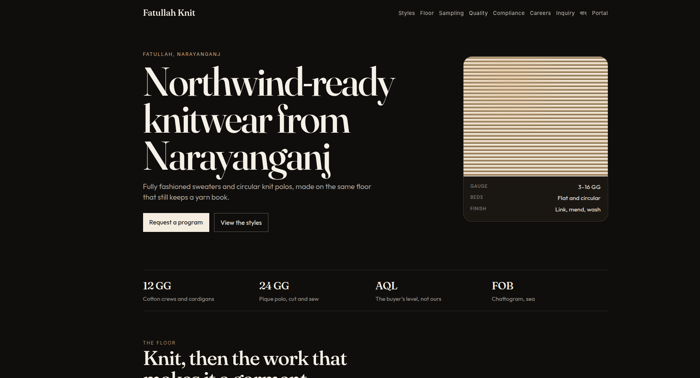
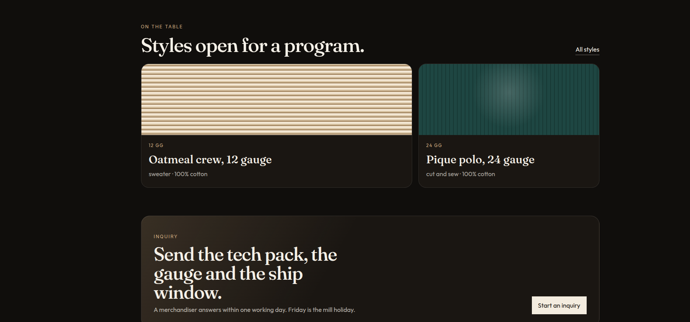
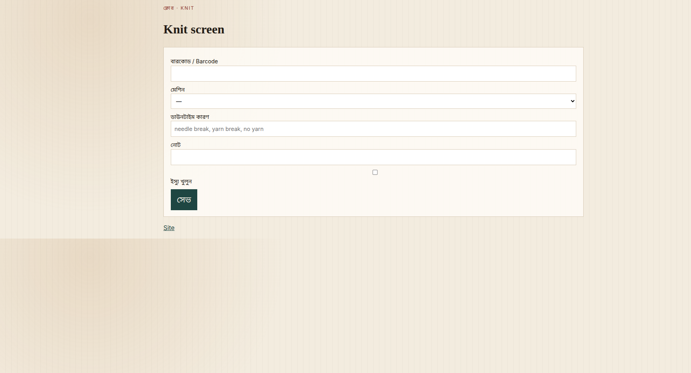
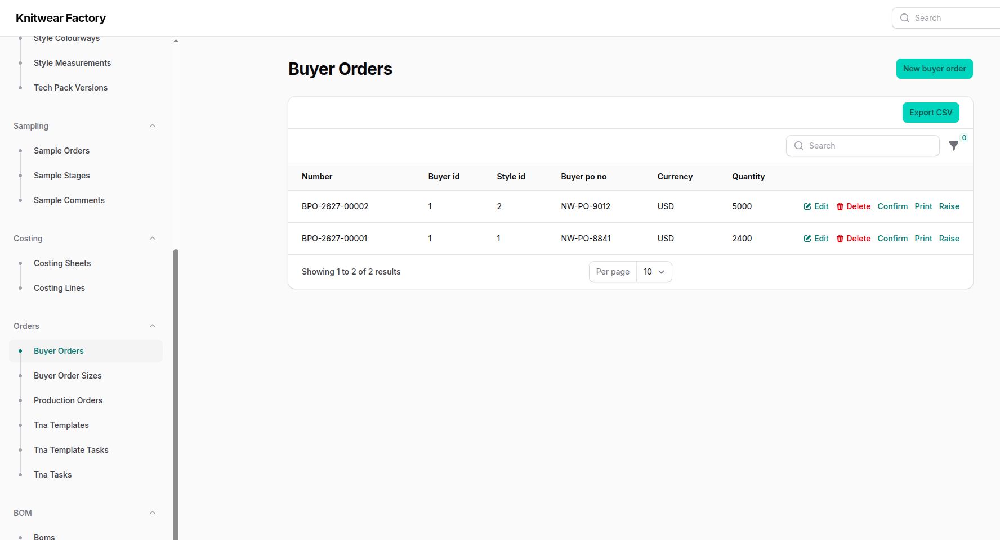
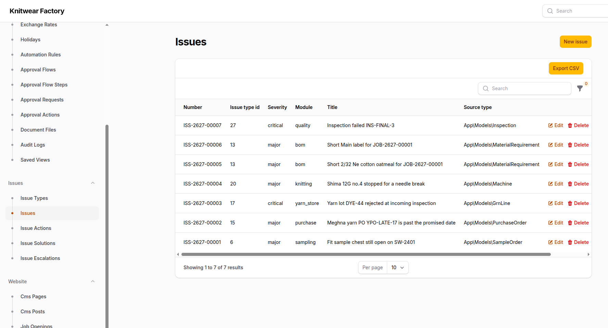
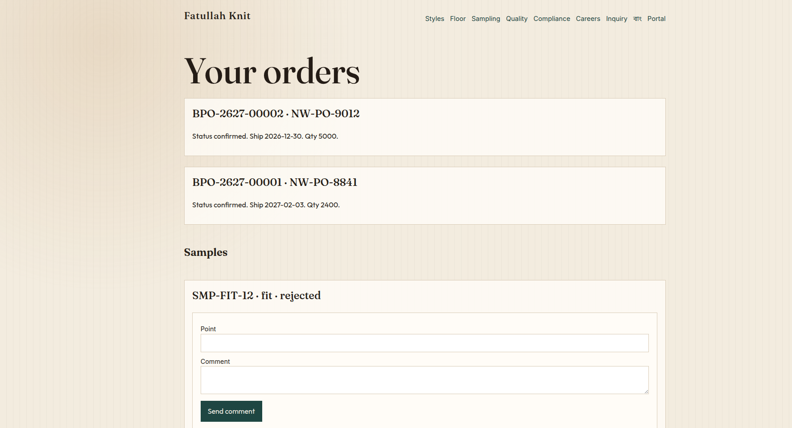

# Knitwear Factory

One system for a knitwear mill that still works the way the floor works: a buyer PO, a TNA counted back from the ship date, yarn in grams, a challan, a shade decision, a bundle, an AQL, and a carton that does not leave if the audit failed.

Sweaters and cardigans run the flat-bed route. Polos and knit tops run cut-and-sew. Both live in the same mill, the same order book, and the same issue board.

English and Bangla. Friday is the weekly holiday. The financial year is July–June, so a yarn PO in November 2026 is `YPO-2627-00045`. Buyer money can be USD, EUR or GBP. The books stay in BDT.



## Who it is for

A managing director who wants one morning picture: orders on hand, ship dates at risk, open issues, and cash.

A merchandiser who is tired of rebuilding the TNA in a spreadsheet every time a buyer moves the ship date.

A yarn store that has issued the wrong dye lot because the shade card and the GRN lived in two books.

A knitting manager who finds a hole at linking, three days after the machine that made it has changed program.

A buyer who calls every afternoon to ask “where is my PO?”

## The hours a mill usually spends, and where they go

These are the hours a traditional sweater program spends on paper, phone calls and rework. They are not a lab benchmark. They are the jobs this system takes off the desk.

| The old job | What it usually costs | What happens here |
|---|---|---|
| Answer a website or email inquiry | A day, then a follow-up call | The form becomes an inquiry at once. Silent after 24 hours, it raises an issue |
| Build a TNA for a new PO | 2–4 hours in a sheet, then it goes stale | Confirm the PO. The calendar walks back from the ship date and skips Friday and holidays |
| Recalculate yarn when the quantity changes | 1–2 hours and a wrong booking | MRP uses grams per piece, wastage, stock on hand and open POs |
| Catch a shade before it is knitted | A lost shift if the cones are already on the machine | A rejected incoming inspection never enters stock, and the lot is an issue |
| Decide an AQL sample | A table lookup and an argument | The inspection is judged. A fail holds the job |
| Chase a late yarn spinner | Morning calls | The late PO is already on the issue board, with an owner and an SLA |
| Tell the buyer the status | 15 minutes a call, several times a week | The buyer portal shows the PO, the ship date and the sample |
| Close a repeated hole on the same machine | It comes back next week | The third repeat on the same machine becomes a chronic issue |
| Explain the books after a GRN | A journal written at month end | A posted GRN writes the voucher once. Posting it again does not double the entry |

On one 2,400-piece sweater and one 5,000-piece polo, that is most of a merchandiser’s week and a storekeeper’s morning, back on the floor instead of on the phone.

## What you can run

Every department has masters, documents, a print, a permission, and a hook into the issue engine. A disabled module hides its menus. Webshell stays off until a super admin turns it on.

### Sell and develop

- Buyers, agents, contacts, visits, payment terms, incoterms, labeling and packing rules, default AQL.
- Inquiries from the website, email or the desk. Quotations with a validity date.
- Styles with gauge, stitch, construction, yarn count, GSM, measurements and a Digital Product Passport.
- Tech-pack versions. Sample types from proto to shipment sample, with buyer comments and a courier AWB.
- Costing that prices yarn, knit waste, link waste, CM, overhead, commission and profit. A quoted price in the buyer’s currency.
- Buyer PO, size and colour matrix, production job, and a TNA template per route.



### Buy, store and knit

- Suppliers, requisitions, RFQ, comparative quotes, yarn PO, GRN, three-way awareness of PO, receipt and bill.
- Yarn lots: count, cones, gross and net weight, moisture, shade, and a mandatory incoming inspection.
- Stock is an append-only ledger. You cannot issue a lot below zero.
- Dyeing challans to an outside dyer, with the loss expected on the way out.
- Flat-bed machines (Shima and the rest) and circular machines. Knit programs. Bundles with a barcode. Fabric rolls for the circular line. Downtime with a real reason: needle break, yarn break, no yarn, no operator, program, power.
- Linking and mending WIP scans. Wash recipes and wash lots. Lab tests for shrinkage, pilling and fastness.
- Cutting orders, sewing lines, operation breakdown with SMV, hourly output and DHU.



### Quality, pack and ship

- A defect library in knitwear language: hole, dropped stitch, laddering, slub, shade bar, uneven rib, twisted link, stain, seam puckering.
- Inline and final inspection. ISO 2859-1 level II sample size. Major, minor and critical. A critical defect fails the lot. A failed final holds the job.
- Packing lists, carton numbers, shipments, commercial documents.

### Commercial, accounts, people

- Export LC, back-to-back LC, bond register (import yarn against export garments).
- Chart of accounts and posting rules. A GRN posts debit yarn, credit goods-received-not-invoiced. The voucher is idempotent on a source key, so a double click does not double the money.
- Employees, shifts, leave, payroll. Basic salary, present days, overtime at double time, and piece rate from linking, mending or sewing.
- Compliance audits, licence expiry, accidents. Maintenance assets and preventive maintenance. Gate visitors, vehicles and gate passes.



## The issue engine

This is the part that replaces the phone.

An issue has a type, a severity, an owner, a clock, a source document, and, when you close it, a root cause, a corrective action and a preventive action. Closure without those three is refused.

It escalates. The owner first, then the general manager, then the managing director.

It notices a repeat. The same fault on the same machine, supplier, yarn lot or defect code, three times in 90 days, opens a chronic parent.

The demo already has the problems a real week produces:

- Fit sample rejected. Chest, size M, still open.
- Meghna yarn PO past the promised date.
- Dye lot DYE-44 failed the shade and stayed out of the ledger.
- Shima 12G stopped for a needle break.
- Yarn short against the approved BOM.
- Final inspection failed. The job is held.



## Two routes, one mill

| | Sweater | Polo and knit top |
|---|---|---|
| Route | `sweater` | `cut_and_sew` |
| Machines | Flat bed, 3–16 gauge | Circular, then cutting |
| Make | Panel, link, mend | Roll, cut, sew |
| Demo style | SW-2401 oatmeal crew, 12 GG, 0.285 kg a piece plus 8% waste | PL-110 pique polo, 24 GG, 220 GSM |
| Demo PO | NW-PO-8841, 2,400 pcs | NW-PO-9012, 5,000 pcs |

Confirming a PO writes the production job and the TNA. The sweater template runs lab dip, yarn booking, yarn in house, fit, PP, knitting, linking, washing, finishing, final inspection, ex-factory.

## What a buyer and a supplier can see

The public site is the front door: capabilities, sampling, quality, compliance, careers, and an inquiry form that lands in merchandising.

The buyer signs in and sees their orders, ship dates, and samples. They can send a comment on a rejected point.

The supplier signs in and sees their purchase orders.



There is also a small assistant. Ask which jobs are at risk, or ask for a style by code. With an AI provider key it will draft from the open-issue count. Without a key it answers from the database and does not sit on a timeout.

## Roles

Super Admin, Managing Director, Director Operations, General Manager, Merchandising Manager, Merchandiser, Sample In-charge, Pattern/CAD Master, Knit Programmer, Purchase Manager, Store In-charge, Knitting Manager, Knitting Supervisor, Linking Supervisor, Mending Supervisor, Washing/Dyeing Manager, Finishing In-charge, Cutting In-charge, Sewing Line Chief, Industrial Engineer, Quality Manager, Line QC, Final Auditor, Packing In-charge, Shipping Manager, Commercial Manager, Accounts Manager, Accountant, HR Manager, Compliance Officer, Maintenance Engineer, Security/Gate, Buyer, Supplier, Auditor.

A user can be limited to a branch. Buyers and suppliers stay on their portals. They do not open the office panels.

## Demo

Password for every seeded user: `Factory#2026`

| Email | Lands on |
|---|---|
| admin@knitwear.test | `/admin` |
| merchandiser@knitwear.test | `/admin` |
| store@knitwear.test | `/admin` |
| knitting@knitwear.test | `/admin` |
| qc@knitwear.test | `/admin` |
| accounts@knitwear.test | `/admin` |
| buyer@knitwear.test | `/portal/buyer` |
| supplier@knitwear.test | `/portal/supplier` |

Panels: `/admin`, `/merchandising`, `/production`, `/store`, `/commercial`, `/hr`, `/compliance`.

Floor, after sign-in: `/floor/knit`, `/floor/qc`, `/floor/store`, `/floor/packing`, `/floor/gate`.

## Run it

```bash
composer install
cp .env.example .env
php artisan key:generate
touch database/database.sqlite
php artisan migrate --seed
php artisan serve
```

Queues and the morning board:

```bash
php artisan schedule:work
php artisan queue:work
```

`factory:scan-exceptions` runs every 15 minutes. `factory:tna-digest` emails at 08:00. On Redis, use `php artisan horizon`.

Tests:

```bash
php artisan test
```

The engine tests cover numbering, a stock issue that would go negative, BOM wastage, costing, a TNA that skips Friday, AQL, payroll double-time and piece rate, an idempotent voucher, SLA escalation, a chronic issue, a rejected yarn lot, and the public inquiry.

## API

Sanctum, prefix `/api/v1`. Create a token for a user and send `Authorization: Bearer …`.

| Method | Path |
|---|---|
| GET | `/api/v1/orders` |
| GET | `/api/v1/orders/{id}` |
| GET | `/api/v1/issues` |
| GET | `/api/v1/production/{id}` |

Print a document from a signed-in session: `/documents/buyer_orders/1`. The PDF is Bangla-safe. The date line on 16 November 2026 reads `১৬ নভেম্বর, ২০২৬`.

## Stack

- Laravel 12, Filament 4, PHP 8.3+.
- SQLite for the demo. MySQL 8 or MariaDB in production. See `.env.example`.
- Redis and Horizon are installed. The demo uses the database for cache, session and queues so it starts without Redis.
- Roles are Spatie permissions. `imrandevbd/adhikar` is not published.
- AI calls go through `imrandevbd/laravel-ai-hub`. Tests use `AIHub::fake()`. No provider key, no network call.

Package gaps, and why Laravel 13 and Filament 5 were not used, are in [docs/PACKAGE_NOTES.md](docs/PACKAGE_NOTES.md).

## More

- [Install and deploy](docs/INSTALL.md) — nginx, cron, Redis, backups
- [Modules](docs/MODULES.md) — each department, the paper step and the automatic step
- [API](docs/API.md)
- [First 30 days](docs/GO_LIVE.md)

## What is still a register

The screens, the stock ledger, the TNA, the MRP, the AQL judgement, the payroll formula and the issue engine are working and tested. A few floor tools from a full mill rollout are the next depth, not a hidden switch: a drag-and-drop knitting Gantt, barcode sync after the network drops, attendance punches flowing straight into payroll, OCR of a tech pack or an LC, WhatsApp, and ZPL carton labels. The registers for those departments are already in the panels, so the mill can record the work while those tools are finished.

## 🤝 Let's Connect & Collaborate

I am open to Senior Remote Full-Stack Roles, AI Platform Architecture Contracts, and Enterprise Technical Advisory.

**Timezone:** UTC+6 (Dhaka / Rangpur, Bangladesh) — Flexible overlap with US, UK, and European business hours.

**Delivery Mode:** Async-ready, Slack, Discord, Jira, GitHub, and production-first accountability.

| Channel | Address / Handle | Quick Action |
|---|---|---|
| 🌐 Primary Portfolio | [imrandev.bd](https://imrandev.bd) | [Visit Site ↗](https://imrandev.bd) |
| 📦 Packagist Packages | [packagist.org/packages/imrandevbd](https://packagist.org/packages/imrandevbd/) | [View Packages ↗](https://packagist.org/packages/imrandevbd/) |
| 💼 LinkedIn Profile | [linkedin.com/in/imranbru99](https://linkedin.com/in/imranbru99) | [Connect ↗](https://linkedin.com/in/imranbru99) |
| 🐙 GitHub Profile | [github.com/imranbru99](https://github.com/imranbru99) | [Follow ↗](https://github.com/imranbru99) |
| 💬 WhatsApp Direct | [+880 1576-918420](https://wa.me/8801576918420) | [Chat Now ↗](https://wa.me/8801576918420) |
| 📧 Direct Email | [me@imrandev.bd](mailto:me@imrandev.bd) | [Send Email ↗](mailto:me@imrandev.bd) |
| 🐦 X (Twitter) | [@imrandev_bd](https://x.com/imrandev_bd) | [Follow ↗](https://x.com/imrandev_bd) |
| 📺 YouTube Tech | [@ImranDevBD](https://www.youtube.com/@ImranDevBD) | [Subscribe ↗](https://www.youtube.com/@ImranDevBD) |
